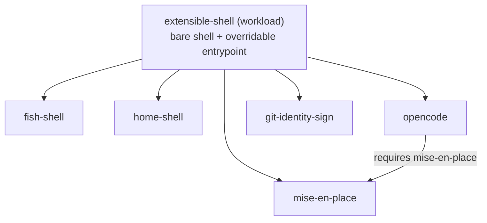

# Docker Sandbox Kits

A collection of [Docker Sandbox](https://docs.docker.com/) kits, intended for sharing with colleagues and teams: a small set of
easy-to-use kits that simplify setting up a well-configured development sandbox built with the `sbx` CLI — one extensible base
workload plus reusable mixins that customize it.

## Design

These kits are **ingredients for building your own sandbox**, not finished recipes: a minimal extensible base, a set of
small, highly reusable parts, and the freedom to compose — or fork and remix — the environment you want. Four choices
give the collection its shape.

### One workload, many mixins

A sandbox boots from exactly one **workload**: the base image the host starts. This repo has exactly one,
[`extensible-shell/`](extensible-shell/) — a shell sandbox with a Docker engine based on Docker's public
`docker.io/sbx/shell-docker-image:latest`, with an overridable `/home/agent/entrypoint.sh`. Everything else is a **mixin**: a small, focused layer that
customizes the sandbox without owning it. Tools and agents are mixins too — [`opencode/`](opencode/) installs its
agent through [`mise`](https://mise.jdx.dev/) rather than defining a second workload. Missing a tool? Write a mixin;
never fork the workload.



### The entrypoint is the seam

`extensible-shell` boots `bash -l` from `/home/agent/entrypoint.sh`; a mixin can rewrite that file from an install
hook to choose what boots instead — [`fish-shell/`](fish-shell/) writes `fish -l`, [`opencode/`](opencode/) writes
`exec opencode`. Overrides are opt-in by convention: the rewrite is gated behind an `auto_start` arg (default
`false`), and a composition turns it on for exactly the one kit that should take over the boot shell. Install hooks
run in dependency order, so a mixin composed after the boot kit can wrap the entrypoint again — the last writer wins.

### Declared dependencies, versioned capabilities

Kits compose without reaching into each other. Dependencies are explicit in both directions: a mixin declares
**requires** ([`opencode/`](opencode/) requires `mise-en-place`), providers declare **provides**, and a composition
fails closed when nothing in the set satisfies a requirement — requirements never pull kits in behind your back.
Customization of the sandbox itself is requested through **capabilities**, versioned units such as `lifecycle@1`
(install/startup hooks, config files), `network-policy@2` (egress allowlist), and `ssh-agent@1`.

### Secure by default

- Network egress is **default-deny at runtime** (install-phase egress is open while install hooks run); a kit that
  downloads anything during a session declares an explicit allow (`mise-en-place` allows `mise*.jdx.dev`, `opencode`
  allows `opencode.ai`).
- [`git-identity-sign/`](git-identity-sign/) scopes the ssh-agent to signing only (`sign: [git]`): commits are signed
  with your key, but remote authentication is not the agent's to perform — it comes from Docker Sandbox secret
  injection at runtime.

## Kits

Each kit is a self-contained directory with a YAML manifest declaring capabilities and the args they consume. Some kits
also ship a Dockerfile for staged installation.

| Kit                                        | Purpose                                                         | Capabilities                      |
|--------------------------------------------|-----------------------------------------------------------------|-----------------------------------|
| [`extensible-shell/`](extensible-shell/)   | **Workload:** bare shell sandbox with an overridable entrypoint | —                                 |
| [`git-identity-sign/`](git-identity-sign/) | Configures Git identity with SSH commit signing                 | `ssh-agent@1`, `lifecycle@1`      |
| [`mise-en-place/`](mise-en-place/)         | Installs and activates the `mise` tool manager                  | `network-policy@2`, `lifecycle@1` |
| [`fish-shell/`](fish-shell/)               | Installs Fish and makes it the `agent` user's login shell       | `lifecycle@1`                     |
| [`home-shell/`](home-shell/)               | Installs the dotfiles shell, editor, and agent tools for `agent` | `lifecycle@1`                     |
| [`opencode/`](opencode/)                   | Installs the [OpenCode](https://opencode.ai/) coding agent via `mise` | `network-policy@2`, `lifecycle@1` |

## Run the dotfiles shell locally

In Fish, from the dotfiles checkout root with local kits enabled in `sbx`, run:

```fish
set kit (bash sandboxes/docker/prepare-home-kit.sh)
and sbx run ./sandboxes/docker/extensible-shell \
    --kit "$kit" \
    --kit-arg home-shell.auto_start=true
```

`extensible-shell` pulls its base from Docker Hub. The shell setup requires no registry credentials. Use `sbx login`
if Docker Sandbox itself prompts you to sign in. [Docker Sandbox base images](https://docs.docker.com/ai/sandboxes/customize/author/base-images/#build-a-custom-agent-on-a-shell-image)

Preparation stages the kit, the Home Manager modules, the shared Rex config, and the flake and lockfile under an
ignored `result-docker-sandbox-kit.*` directory. `sbx` fetches the pinned Nix inputs and builds the kit for the sandbox
architecture, using `docker-sandbox-arm` on ARM64 and `docker-sandbox` on x86-64. The build packages Home Manager's
files and their runtime dependencies. The install hooks put the files in `/home/agent` and register Fish as the login
shell. The running shell requires no Nix installation.

`home-shell` supplies `fish-shell` in this composition. It uses the shared Fish and Starship settings, including the
`z` and `fzf` plugins, and keeps the devenv hook and Colima shortcuts in the regular Fish module. Rerun preparation and
launch a fresh sandbox after changing the shared settings. In the new session, `status is-login` should succeed and
`functions fish_prompt` should show Starship's prompt function.

The kit also puts `nvim`, `hunk`, `rex`, and `pi` on the Fish `PATH`. Neovim uses the nixpkgs package. Rex gets the
shared Ctrl+A bindings and terminal description. Pi starts with the shared interface preferences in a writable
`~/.pi/agent/settings.json`. Provider access depends on the sandbox's network policy and runtime credentials.
[A Docker Sandbox credential guide](https://docs.docker.com/ai/sandboxes/configuration/credentials/)

## Kit anatomy

```
<kit>/
    <kit>.yaml            # manifest: displayName, args, capabilities[]
    <kit>.dockerfile      # optional, for two-stage installs
```

- **Capabilities** are versioned units of customization: `ssh-agent@1`, `lifecycle@1`,
  `network-policy@2`.
- **Args** (e.g. `git_user_name`, `git_user_email`, `git_user_signingKey`) are declared under `args:` and referenced as
  `${{ kit.args.NAME }}`.

## Documentation

- [Author kits](https://docs.docker.com/ai/sandboxes/customize/author/) — descriptor and Dockerfile layout, capabilities, lifecycle hooks
- [Use kits](https://docs.docker.com/ai/sandboxes/customize/use-kits/) — running and combining kits with `sbx run` and `--kit`
- [Build and distribute kits](https://docs.docker.com/ai/sandboxes/customize/author/distribute/) — publishing kit images to a registry
- [docker/sbx-kits-contrib](https://github.com/docker/sbx-kits-contrib) — Docker's community kit sources and kit spec
- Tools shipped by these kits: [mise](https://mise.jdx.dev/), [fish](https://fishshell.com/), [opencode](https://opencode.ai/)
